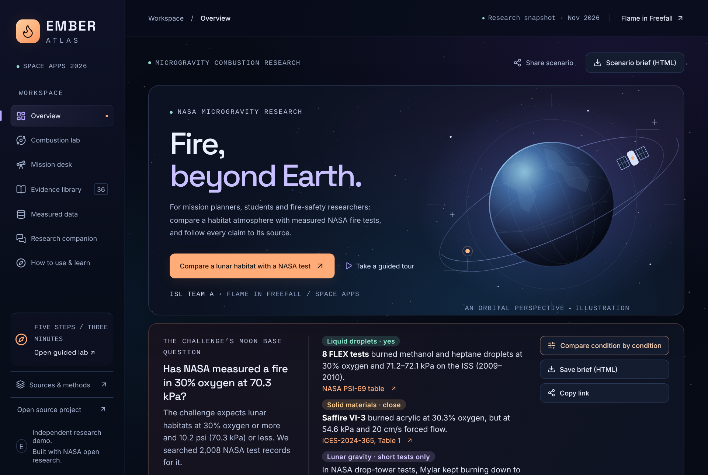
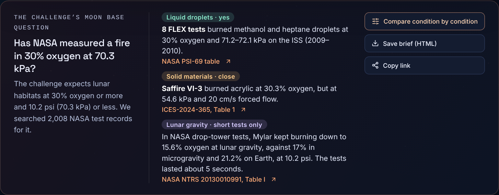
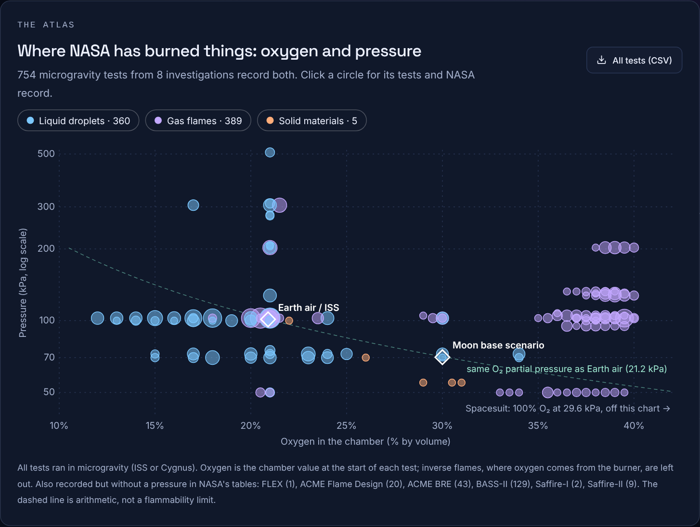
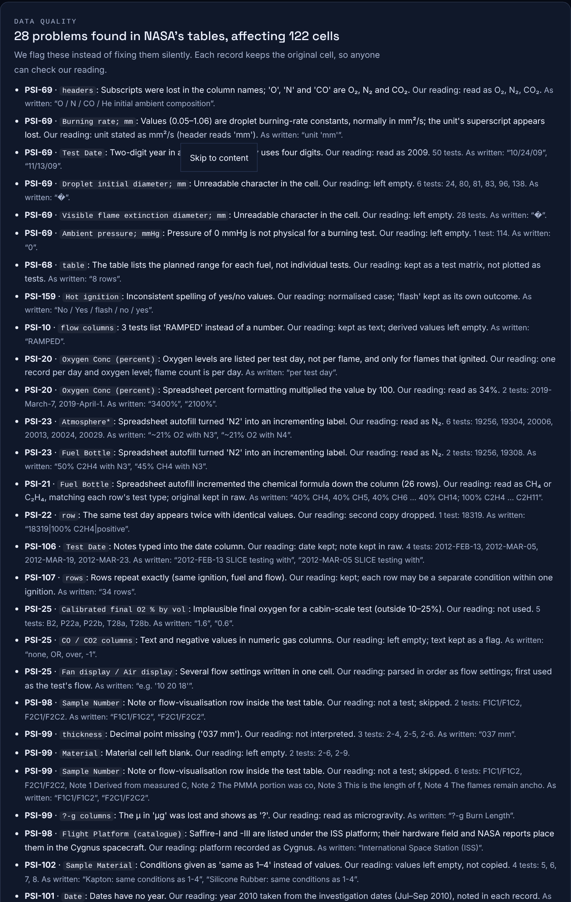
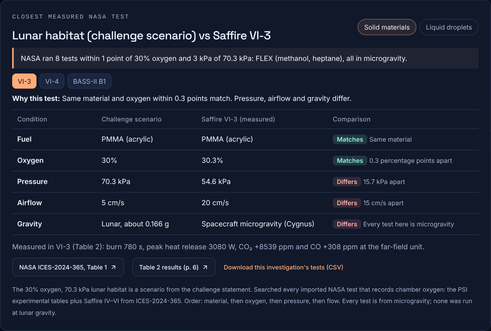
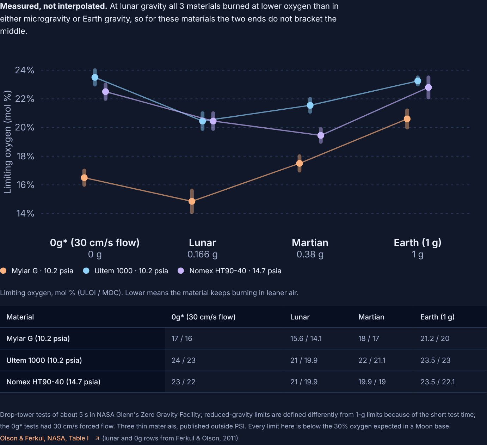

# EMBER Atlas

**Fire, beyond Earth.** Every NASA microgravity combustion test we could find, in one searchable atlas, so a habitat designer can ask "has NASA burned anything like my cabin?" and get a cited answer in one click.

[**Live site: emberatlas.tech**](https://emberatlas.tech) · [Slides (PDF)](submission/EMBER-Atlas-Space-Apps-2026.pdf) · [Submission text](submission/SUBMISSION.md)

Built by **ISL Team A** (Hiba Waheed Ch, Zaafir Abbas Haidrie, Muhammad Ashar Hassan, Amin Adnan Mahmood) for the NASA Space Apps Challenge 2026 challenge **[Flame in Freefall: SI-Powered Fire Safety Insights from Microgravity Combustion Data](https://www.spaceappschallenge.org/2026/challenges/flame-in-freefall/)**.



---

## What we found

The challenge expects a Moon base to run at **30% oxygen or more and 10.2 psi (70.3 kPa) or less**. We imported 2,008 NASA test records and asked: has NASA burned anything there?

1. **Liquid droplets: yes.** NASA's FLEX experiment burned methanol and heptane droplets at 30% oxygen and 71.2–72.1 kPa eight times on the ISS in 2009–2010 (PSI-69, tests 25–28 and 40–43).
2. **Solid materials: close, not exact.** The nearest is Saffire VI-3, acrylic at 30.3% oxygen, but at 54.6 kPa with 20 cm/s forced flow (NASA ICES-2024-365, Table 1).
3. **Lunar gravity: measured, briefly.** In NASA drop-tower tests, Mylar kept burning down to 15.6% oxygen at lunar gravity, against 17.0% in microgravity and 21.2% on Earth, at 10.2 psia. All three materials tested burned at lower oxygen at lunar and Martian gravity than at either end, so microgravity and Earth results did not bracket the middle (Olson & Ferkul, NASA, Table I; about 5-second tests, outside PSI).



## The data

| Layer | What it is | What it is not |
| --- | --- | --- |
| **NASA test records** | 2,008 rows from the experimental tables of 21 NASA PSI combustion investigations (FLEX, CFI, ACME CFI-G, Flame Design, BRE, s-Flame, CLD, E-FIELD, SLICE, SPICE, BASS, BASS-II, Saffire I–III, SAME, SAME-R, DAFT) plus Saffire IV–VI from ICES-2024-365. Downloaded through PSI's public API, checksummed, units converted in code, original cells kept | Raw telemetry or video; PSI's own files run to terabytes |
| **Data quality** | 28 problems found in NASA's tables, affecting 122 cells, each flagged with our reading: lost subscripts and units, spreadsheet autofill ("40% CH4, CH5 … CH14"), percent formatting ("3400%"), unreadable characters, implausible values | Silent fixes; every record keeps the cell as written |
| **Partial-gravity limits** | Limiting oxygen at 0g, lunar, Martian and Earth gravity for Mylar, Ultem and Nomex, checked against the NASA PDF | Long-duration tests or more than three materials |
| **BASS-II spread rates** | 39 flame-spread values from 18 runs, Table 5.1 of NASA/TM-20210011385, checked by eye against the PDF; they agree with PSI's BASS-II table for every run | Independent experiments; oxygen fell during every run |
| **Findings** | 36 curated summaries of 23 NASA sources, each with meaning and limits | A complete literature review |
| **3D flame** | An authored illustration; only the oxygen partial-pressure arithmetic is physical | CFD, a temperature map or a risk score |





## What you can do

| Area | What it does |
| --- | --- |
| **Homepage** | The Moon base question answered three ways (droplets, solids, gravity), the oxygen × pressure map of 754 tests, and a one-page brief or share link. |
| **Combustion lab** | Set oxygen, pressure, airflow, gravity and fuel; the nearest measured NASA tests (from all 2,008) appear condition by condition with what matches and what differs. Measured lunar and Martian gravity limits are charted below. A 3D flame illustrates the setting and replays BASS-II measurements. |
| **Mission desk** | Pick a habitat and a safety question; investigations are ranked with a reason for each, compared side by side, and grouped by shared hardware. Measured detection and extinction examples. |
| **Measured data** | Every imported NASA table with counts and ranges, the data-quality list, CSV downloads of any investigation, and the BASS-II chart. |
| **Evidence library** | 36 findings, searchable in plain words (*acrylic* finds PMMA), each with its source and limits. |
| **Research companion** | Claude Haiku 5.5 answers from the retrieved findings **and the matching NASA test rows**, citing each row; it declines what the evidence cannot support. |





## How it works

```text
NASA PSI API ──fetch-psi.mjs──► data/psi/raw/*.csv (21 tables, SHA-256 in manifest.json)
                                      │
                         build-tests.mjs: parse, convert units, flag quirks
                                      ▼
                   data/tests.json (2,008 records) · tests-compact.json (browser)
                                      │
Browser (Next.js + React) ◄───────────┤──► /api/tests (filter, CSV)
  ├─ Atlas map, nearest-test engine, gravity chart (SVG)
  ├─ Three.js volumetric flame (CPU particle fallback)
  └─ Questions ──► /api/ask
                     ├─ BM25 search over findings + investigation profiles
                     ├─ Matching NASA test rows (conditions, superlatives, named investigations)
                     ├─ Claude Haiku 5.5 via Vercel AI Gateway, structured output with cited IDs
                     ├─ Citation check (unknown IDs rejected), answer cache, per-device rate limit
                     └─ Fallback: the matching findings, shown directly
```

| Endpoint | Purpose |
| --- | --- |
| `GET /api/tests?investigation=FLEX&o2Min=29&o2Max=31&format=csv` | Filter the 2,008 NASA test records; JSON or CSV with PSI record links |
| `GET /api/health` | Version, deployed build, record counts and AI mode |
| `GET /api/evidence?q=airflow` | Curated findings, optionally ranked by search |
| `POST /api/ask` | `{ question, history? }` → AI answer citing findings and test rows, or search results |
| `POST /api/analyze` | Lab scenario → notes, findings, nearest tests and an AI interpretation |
| `POST /api/investigations` | `{ destination, priority }` → ranked profiles with reasons |
| `POST /api/compare` | AI explanation of 2–3 selected profiles |
| `POST /api/import` | Validated CSV/JSON upload, marked unverified |

### The AI: Claude, kept honest

- **Model:** Anthropic Claude Haiku 5.5 through the Vercel AI SDK and Vercel AI Gateway, authenticated with Vercel OIDC (no stored API key).
- **Grounding:** the server chooses what the model sees: retrieved findings, investigation profiles and NASA test rows picked deterministically (conditions named in the question, "fastest/highest" sorts over a whole table, per-investigation condition grids). Never the open web.
- **Checking:** structured output lists the IDs used; an answer citing anything it was not given is rejected. Numbers in answers come from the rows supplied.
- **Cost and demo safety:** repeat questions, lab interpretations and comparisons are cached; 30 calls per device per 10 minutes; a $5/month AI Gateway budget; a search-only fallback.
- **Evaluation:** `scripts/ai-eval.mjs` runs 22 live checks, including data questions (fastest BASS-II run, FLEX conditions, tests at the Moon base atmosphere, an unsupported atmosphere). Results and reviewer notes: `docs/ANSWER-CHECK.md`. Checked citations are not a scientific review of every sentence.

## Development process

1. **Foundation (November 14).** Dashboard, animated 3D lab, evidence library with provenance, Mission desk ranking, field guide, dark galaxy design.
2. **Challenge resources (November 14).** Resource inventory; BASS-II Table 5.1 verified against the 49 MB report and expanded to all 18 tracked runs.
3. **Challenge coverage and AI (November 14–15).** The investigations the challenge names, crew atmospheres, Earth applications, Claude Haiku 5.5 with citation checks and a live evaluation.
4. **External review (November 15).** Saffire IV–VI records, condition-by-condition comparison, scoped partial-gravity claims, ranking reasons, detection and extinction examples, a one-page brief, an answer check.
5. **The data layer (November 15).** Found PSI's public API, imported 2,008 test records from 21 tables with checksums and 28 flagged data problems, rebuilt the nearest-test search on them, added the measured lunar- and Mars-gravity limits, the oxygen × pressure map, and AI answers from test rows; raised every font to 12 px or more and reworked the flame colours.

Every change is tested with strict TypeScript and 36 automated tests, a production build, browser checks on desktop and phone, and live AI checks. See `docs/VALIDATION.md`.

## Run it locally

Requires Node.js 20.9+ and npm. Everything except AI answers works offline, with no accounts or keys.

```sh
npm ci
npm run dev          # http://localhost:3000
npm run check        # strict TypeScript + 36 tests
npm run build && npm start
```

To try AI answers locally, copy `.env.example` to `.env.local` and set `ENABLE_GENERATIVE_AI=true`, `AI_MODEL=anthropic/claude-haiku-5.5` and an `AI_GATEWAY_API_KEY`. Never commit `.env.local`. Without these, the app shows search-based answers.

Run the live AI checks against any deployment:

```sh
node scripts/ai-eval.mjs https://emberatlas.tech
```

Refresh NASA's tables and rebuild the dataset:

```sh
NODE_USE_ENV_PROXY=1 node scripts/fetch-psi.mjs   # re-download and compare checksums
node scripts/build-tests.mjs                      # verify checksums, rebuild data/tests.json
```

## Deployment

Vercel project `ember-atlas`, connected to this repository; every push to `main` deploys to [emberatlas.tech](https://emberatlas.tech) (also [ember-atlas-sigma.vercel.app](https://ember-atlas-sigma.vercel.app)). Framework preset Next.js, install `npm ci`, build `npm run build`. Other Node hosts can run `npm ci && npm run build && npm start`.

## Limits and next steps

EMBER Atlas is a research and teaching tool, not a fire-safety certification. Every NASA test in the tables ran in microgravity; the partial-gravity limits come from about 5-second drop-tower tests on three materials. Next steps: add LUCI and FM2 lunar-gravity results when NASA releases them, ingest the files behind the PSI tables (video, time series), and have a combustion scientist review the findings, rankings and our reading of each data quirk.

## Project docs

- [docs/VALIDATION.md](docs/VALIDATION.md): dated record of what was tested and verified, including the live AI checks.
- [docs/CHALLENGE-ALIGNMENT.md](docs/CHALLENGE-ALIGNMENT.md): how each challenge objective maps to a feature.
- [docs/RESOURCES-2026-11-13.md](docs/RESOURCES-2026-11-13.md): inventory of the official challenge resources.
- [docs/DEMO.md](docs/DEMO.md): three-minute demo script, starting on the Moon base question.
- [docs/ANSWER-CHECK.md](docs/ANSWER-CHECK.md): research-companion answers checked against their retrieved findings and source passages.
- [docs/USER-TRIAL.md](docs/USER-TRIAL.md): task-based user-trial protocol and recording sheet.
- [docs/REVIEW-CHECKLIST.md](docs/REVIEW-CHECKLIST.md): each item of the November 14 review and what was done.

## License and attribution

Original application code: MIT, © 2026 Hiba Waheed and ISL Team A. Research material remains attributed to its original NASA sources; NASA PSI records used here identify CC0 dataset licenses. No NASA insignia is used. Independent project; no NASA endorsement or affiliation.
